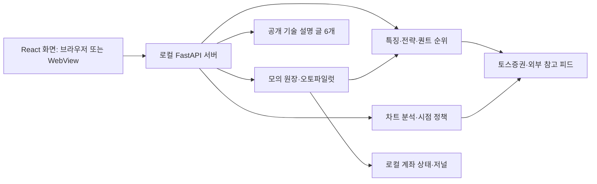

# Earningzone

### 주식 분석·차트 연구·모의매매를 위한 로컬 워크스테이션

[English](README.md) · **한국어**

Earningzone은 시장 분석, 퀀트 종목 발굴, 차트 해석, 모의계좌 운용, 전략 평가를 하나의 브라우저 또는 Windows 데스크톱 앱에서 제공하는 독립 프로젝트입니다. React 인터페이스, 로컬 FastAPI 서버, Python 분석 엔진으로 구성되며 **토스증권 Open API**의 시장 데이터와 선택형 외부 참고 피드를 연동합니다.

**저장소:** [minyoungci/Earningzone](https://github.com/minyoungci/Earningzone). Python 패키지, 앱 파일, 실행 파일과 로컬 상태 폴더는 기존 `tossbot` 이름을 사용합니다.

분석 규칙을 직접 확인하고 전략을 실험하면서 매매 판단이 어떤 과정으로 만들어지는지 이해하려는 개발자와 개인 연구자를 위한 도구입니다.

**현재 구현 범위:** 웹 모의투자와 오토파일럿은 로컬 모의 원장을 사용합니다. 차트 확인 정책은 실험 기능이고 점수는 휴리스틱입니다. 기존 백테스트가 이 정책의 수익성을 입증하는 것은 아닙니다. 현재 앱 인터페이스와 앱 안의 기술 설명 글 6개는 주로 한국어이며, 프로젝트 실행 매뉴얼은 영어와 한국어로 제공합니다.

**라이선스 상태:** 프로젝트 `LICENSE`는 아직 채택하지 않았습니다. 소스 저장소에는 두 언어의 문서가 포함되고 개인 금융 자료는 제외합니다. 현재 재사용 범위는 [공개와 라이선스](#공개와-라이선스)를 확인하세요.

## 목차

- [주요 기능](#주요-기능)
- [토스증권 API 연동](#토스증권-api-연동)
- [빠른 시작](#빠른-시작)
- [첫 사용 순서](#첫-사용-순서)
- [설정과 상태 저장](#설정과-상태-저장)
- [아키텍처와 구성 요소](#아키텍처와-구성-요소)
- [분석과 매매 로직](#분석과-매매-로직)
- [개발 환경과 API](#개발-환경과-api)
- [테스트와 검증](#테스트와-검증)
- [패키징과 개인 자료](#패키징과-개인-자료)
- [문제 해결](#문제-해결)
- [기술 설명 문서](#기술-설명-문서)
- [기여 방법](#기여-방법)
- [공개와 라이선스](#공개와-라이선스)

## 주요 기능

| 화면 | 제공 기능 |
|---|---|
| 대시보드 | 관심종목, 계좌 요약, 자산 구성, 분석 신호 |
| 마켓 | 시장 레짐, 매크로 맥락, 뉴스, 경제·실적 캘린더 |
| 인트라데이 | 1분봉, VWAP, 분봉 전용 신호 |
| 퀀트 | 팩터 점수, 선정된 종목 유니버스, 진입 계획, 활동성 지표 |
| 종목 상세 | 전략 결과, 일봉·분봉, 확인 피벗, 리테스트, 다이버전스 |
| 모의투자 | 최대 8개 독립 계좌, 원화·달러 평가, 수동 모의 주문, 매매 저널 |
| 오토파일럿 | 계좌별 모의 진입·청산, 시장 가드, 저장된 보유 계획 |
| 백테스트 | 집계 신호의 워크포워드 평가와 전략군별 비교 |
| 포트폴리오 | 해당 계좌·브로커 경로의 보유 및 포트폴리오 요약 |
| 분석 스터디 | 현재 구현과 한계를 설명하는 공개 글 6개·본문 검색 |

전략 레지스트리는 6개 범주의 **일봉 전략 94개**와 **추가 분봉 전략 5개**를 포함합니다. 퀀트 스크리닝은 선정된 코스피·코스닥·미국 대형주·미국 성장주 유니버스를 사용합니다. 전체 상장 종목을 빠짐없이 분석하는 기능은 아닙니다.

차트 도구는 EMA/SMA, 꼬리·몸통 피벗, 고정 ATR 구간, 돌파·리테스트의 순서 추적, RSI/MACD 다이버전스, RVOL, 방향 거래량 대리값, 갭, 실현 변동성을 제공합니다. 수동 도구로 피보나치 되돌림, 추세선, 측정 목표, IV 가정에 따른 예상 변동폭, 비용을 반영한 위험 수량을 계산할 수 있습니다.

## 토스증권 API 연동

Earningzone은 `https://openapi.tossinvest.com`의 **토스증권 Open API**를 연동합니다. [tossbot/client.py](tossbot/client.py)에서 REST 폴링을 사용하며, 현재 앱에는 제공자의 WebSocket 스트리밍 연동을 구현하지 않았습니다.

| 연동 영역 | 클라이언트 동작 |
|---|---|
| 인증 | `POST /oauth2/token`의 OAuth 2.0 Client Credentials; 이후 요청에는 Bearer 토큰 사용 |
| 시장 데이터 | 현재가, 호가, 최근 체결, 가격 제한, 일봉·1분봉 조회 |
| 참고 데이터 | 종목 기본 정보, 한국·미국 시장 캘린더, USD/KRW 참고 환율 |
| 계좌 조회 | 계좌 목록, 보유 종목, 매수 가능 금액, 매도 가능 수량; 계좌별 요청은 `X-Tossinvest-Account` 추가 |
| 저수준 주문 어댑터 | 주문 생성·취소·상태 조회; `TOSS_DRY_RUN=1`이면 어댑터가 주문을 전송하지 않음 |

클라이언트는 액세스 토큰을 메모리에 캐시하고 만료 전에 갱신하며 동시 발급을 직렬화합니다. API 그룹별 호출 간격과 HTTP 401/429의 제한된 재시도도 구현합니다. 이는 로컬 구현의 보호 장치이며 제공자의 호출 한도나 데이터 가용성을 보장하지 않습니다.

본인의 `TOSS_CLIENT_ID`, `TOSS_CLIENT_SECRET`을 앱 설정, OS 키체인 또는 환경변수로 설정합니다. 문서의 브라우저·데스크톱 흐름에서는 로컬 Python 백엔드가 키를 처리합니다. 필요한 경우 제공자 설정에서 현재 장치의 공인 IP를 허용 목록에 등록하세요. 실제 키와 계좌 기록은 저장소에 포함하지 않습니다.

웹 모의투자와 오토파일럿은 실제 API 데이터를 관측값으로 사용하되 **체결은 로컬 모의 원장에서 처리**합니다. 시장 데이터 조회나 웹 오토파일럿 시작이 토스증권 주문 전송으로 이어지지는 않습니다. 별도의 저수준 주문 어댑터를 검증된 실거래 서비스로 해석하면 안 됩니다.

공식 참고: [개발자 가이드](https://developers.tossinvest.com/), [현재 REST OpenAPI 명세](https://openapi.tossinvest.com/openapi-docs/latest/openapi.json), [WebSocket AsyncAPI 명세](https://openapi.tossinvest.com/openapi-docs/latest/asyncapi.json). **2026-10-06** 확인 시 REST 명세 버전은 **1.2.19**였습니다. API 권한, 한도, 시장 데이터 이용과 제공 범위는 제공자의 현재 조건을 따릅니다. 기존 [로컬 통합 가이드](TOSS_GUIDE.md)는 과거 시점의 참고 문서이며 현재 공식 명세가 아닙니다.

## 빠른 시작

저장소를 복제한 뒤 이 `README.md`가 있는 프로젝트 루트에서 나머지 명령을 실행합니다.

```shell
git clone https://github.com/minyoungci/Earningzone.git
cd Earningzone
```

### 실행 환경

| 실행 방식 | 필요한 환경 |
|---|---|
| 소스 → 로컬 브라우저 | Python 3.10 이상, 최초 프론트 빌드용 Node.js/npm, 현대적인 브라우저 |
| 웹 배포 ZIP | Python 3.10 이상; 프론트는 이미 빌드되어 포함 |
| Windows EXE | Edge WebView2가 있는 Windows; Python은 포함되고 실행 시 Node.js는 불필요 |
| 실제 시장 데이터 조회 | 네트워크와 유효한 토스증권 API 키 |
| 오프라인 검증 | 시장 데이터 키 없이 아래의 합성 테스트 도구 사용 |

현재 Vite 5의 엔진 조건인 `^18.0.0 || >=20.0.0`을 만족하면서 유지보수되는 Node.js 버전을 사용하세요. 최근 로컬 검증 환경은 Windows의 Python 3.13·Node.js 22.15.1입니다. macOS/Linux 브라우저 실행 스크립트도 제공하지만 Windows 패키지와 같은 수준의 플랫폼 검증을 수행한 것은 아닙니다.

### A. 소스에서 실행

프론트엔드를 최초 한 번 빌드합니다. Git 소스는 `web/dist`를 제외하므로 이 단계를 생략하면 운영용 앱 화면이 제공되지 않습니다.

```shell
cd web
npm ci
npm run build
cd ..
```

이후 로컬 브라우저 앱을 시작합니다.

**Windows — PowerShell:**

```powershell
.\run.bat
```

**macOS / Linux:**

```bash
chmod +x run.sh
./run.sh
```

실행 스크립트는 `.venv`를 만들고 필요한 경우 고정된 서버 의존성을 설치한 뒤 서버가 준비되면 브라우저를 엽니다. `127.0.0.1`에 바인딩하고 기본 포트 `8000`이 사용 중이면 빈 포트를 선택합니다. 터미널에 실제로 출력된 URL을 사용하세요. 서버 종료는 `Ctrl+C`입니다.

Python 환경을 직접 구성하려면 가상환경의 인터프리터를 바로 사용할 수 있습니다. 가상환경 활성화는 필수가 아닙니다.

**Windows:**

```powershell
python -m venv .venv
.\.venv\Scripts\python.exe -m pip install -r server/requirements.txt
.\.venv\Scripts\python.exe server/launch.py --no-browser
```

**macOS / Linux:**

```bash
python3 -m venv .venv
.venv/bin/python -m pip install -r server/requirements.txt
.venv/bin/python server/launch.py --no-browser
```

수동 실행도 앞서 설명한 프론트 빌드가 필요합니다. `--no-browser`를 사용하면 출력된 주소를 직접 여세요.

### B. 웹 배포 ZIP에서 실행

`tossbot-app.zip`을 풀고 내부 `tossbot-app` 폴더에서 Windows는 `run.bat`, macOS/Linux는 `./run.sh`를 실행합니다. macOS/Linux에서 압축 해제 후 실행 권한이 없다면 먼저 `chmod +x run.sh`를 실행하세요. ZIP에는 `web/dist`가 들어 있어 실행에 Node.js와 프론트 빌드가 필요하지 않습니다. 최초 Python 의존성 설치와 시장 데이터 기능에는 네트워크가 필요합니다.

현재 ZIP은 로컬에서 생성한 배포 파일입니다. 실제로 공개하기 전에는 GitHub Release가 존재한다고 가정하지 마세요.

### C. Windows 데스크톱 앱 실행

폴더형 빌드는 `dist/tossbot` 전체를 함께 보관하고 그 안의 `tossbot.exe`를 실행합니다. `_internal`은 필수 런타임 파일이므로 따로 떼어내면 안 됩니다. 단일 파일형은 `dist/tossbot.exe`를 실행합니다.

데스크톱 진입점은 빈 루프백 포트의 내장 서버와 네이티브 WebView 창을 실행합니다. API 키는 앱에서 설정하세요. 현재 Windows EXE는 코드 서명이 없으며, 코드 서명과 공식 배포 채널은 릴리스 준비 항목입니다.

### 선택 사항: 전체 종목명 검색 목록

공개 소스·ZIP은 코드에 포함된 선정 종목 검색 목록을 사용합니다. 내려받은 `tossbot/stock_master.json`은 Git과 웹 ZIP에서 제외하고 기존 로컬 파일은 보존합니다. 목록 밖의 종목도 코드를 입력하면 실제 제공자를 통해 확인할 수 있습니다.

더 넓은 종목명 검색 목록이 필요하다면 KRX/Nasdaq의 접근·데이터 이용 조건을 먼저 확인한 뒤 로컬에서 생성합니다.

```shell
python build_master.py
```

생성 후 앱을 다시 시작하세요. 외부 상장 목록을 내려받으므로 네트워크가 필요하며, 퀀트 전략의 선정 종목 유니버스가 확대되는 것은 아닙니다. 생성 파일을 재배포하려면 별도로 데이터 권리를 검토해야 합니다.

## 첫 사용 순서

1. 앱을 실행하고 연결 배너 또는 설정에서 `TOSS_CLIENT_ID`와 `TOSS_CLIENT_SECRET`을 입력합니다. 키는 백엔드에서 처리합니다. OS 키체인이 있으면 저장할 수 있고, 사용할 수 없으면 이번 세션에만 적용된다는 결과를 표시합니다.
2. 키에 허용 IP 제한이 있다면 제공자의 키 설정에서 현재 환경의 공인 IP를 등록합니다. 네트워크를 바꾸면 허용 목록도 갱신해야 할 수 있습니다.
3. 검색 또는 관심종목으로 종목을 엽니다. 신호를 해석하기 전에 관측 시각, 데이터 품질, 확보된 이력을 확인합니다.
4. **모의투자**에서 대상 계좌와 현금·보유 종목을 확인합니다. 수동 모의 주문과 계좌 전환은 차트의 수동 그리기 도구와 별개입니다.
5. **오토파일럿**에서 계좌, 시장, 전략, 최대 보유 수와 예산을 선택합니다. 실험적인 차트 정책은 위험 비율과 최소 순손익비도 확인합니다. **시작**을 눌러야 실행되고 **중지**로 멈춥니다.
6. 저널과 **분석 스터디**의 공개 글에서 결과가 어떤 규칙으로 만들어졌는지 확인합니다.

오토파일럿은 시작할 때 대상 계좌를 고정합니다. 화면의 활성 계좌를 바꿔도 실행 계좌가 바뀌지 않습니다. 중지는 추가 루프 처리를 멈추는 동작이며 보유 종목을 모두 매도하거나 브로커 주문을 취소하지 않습니다. 보유 계획은 저장되지만 루프·앱이 중지된 동안 가격 보호는 동작하지 않습니다.

## 설정과 상태 저장

### API 키

브라우저 실행 스크립트와 데스크톱 소스 진입점의 시작 설정 우선순위는 다음과 같습니다.

```text
명시적인 프로세스 환경변수 → 로컬 .env → OS 키체인
```

앱에서 키를 입력하면 `.env`를 만들지 않아도 됩니다. 파일로 설정하려면 [.env.example](.env.example)을 직접 복사하고 예제 값을 실제 값으로 바꾼 뒤 서버를 시작합니다. 실행 스크립트가 자동으로 복사하지는 않습니다.

```powershell
Copy-Item .env.example .env
```

```bash
cp .env.example .env
```

이 복사 명령은 기존 `.env`가 없을 때만 사용하세요. 문서의 연구·모의매매 흐름에서는 `TOSS_DRY_RUN=1`을 유지합니다. 패키징된 EXE는 앱·키체인 또는 명시적인 환경변수를 사용하세요. EXE 옆에 `.env`를 놓는 방식은 현재 지원 대상으로 문서화하지 않습니다.

| 환경변수 | 역할 | 기본값·동작 |
|---|---|---|
| `TOSS_CLIENT_ID`, `TOSS_CLIENT_SECRET` | 토스증권 API 키 | 실제 데이터 조회에 필요; 앱에서 입력 가능 |
| `TOSS_DRY_RUN` | 저수준 주문 클라이언트의 DRY_RUN | 기본 `1`; 웹 모의투자·오토파일럿은 로컬 모의 원장 사용 |
| `TOSSBOT_DATA_DIR` | 로컬 상태 저장 폴더 지정 | 소스는 프로젝트 루트, EXE는 영구 앱 폴더 |
| `ACCESS_TOKEN` | API 변경 요청을 제어하는 토큰 | 빈 값이면 토큰 가드가 꺼짐; GET은 공개 접근 |
| `CORS_ORIGINS` | 추가 프론트엔드 출처 허용 | 정확한 출처를 쉼표로 구분; 루프백 출처 지원 |
| `TOSS_API_URL` | Vite 개발 프록시 대상 | 기본 `http://127.0.0.1:8000`; 프론트 개발 서버 시작 전에 설정 |
| `BROKER` | 저수준 브로커 기본 선택 | 기본 `toss`; 선택형 `kis` 연동 |
| `KIS_APP_KEY`, `KIS_APP_SECRET`, `KIS_ACCOUNT` | 선택형 KIS 클라이언트 설정 | 직접 설정할 때만 사용; 웹 모의 주문이 실주문으로 바뀌지 않음 |
| `KIS_PAPER` | KIS 서버 선택 | 기본 `1`은 VTS 서버 |
| `TELEGRAM_BOT_TOKEN`, `TELEGRAM_CHAT_ID` | 선택형 알림과 Telegram 컨트롤 | 미설정 시 비활성 |
| `DISCORD_WEBHOOK_URL` | 선택형 Discord 알림 | 미설정 시 비활성 |

CLI `run.py`는 프로세스 환경변수를 직접 읽으며 실행 스크립트의 `.env`·키체인 로드를 수행하지 않습니다. CLI를 사용할 때는 필요한 변수를 먼저 환경에 설정하세요.

### 로컬 상태

| 실행 방식 | 기본 상태 저장 위치 |
|---|---|
| 소스·브라우저 | 프로젝트 루트 |
| 패키징된 Windows EXE | `%APPDATA%\tossbot` |
| 명시적인 위치 지정 | `TOSSBOT_DATA_DIR`의 폴더 |

모의 원장, 브로커 선택, CLI 페이퍼 포트폴리오는 서로 다른 상태 파일입니다. 모의 포지션의 실행 계획과 사용한 차트 신호는 계좌에 저장됩니다. 초기화 전에는 상태를 백업하세요. 손상된 원장은 빈 계좌로 조용히 덮어쓰지 않고 오류로 표시합니다. 일반적인 Windows 설치의 데스크톱 진단 로그는 `%APPDATA%\tossbot\desktop.log`입니다.

### 접근 범위

기본 실행 스크립트는 루프백에 바인딩합니다. GitHub에 소스를 공개하는 것은 서버를 외부에 배포하는 것과 다릅니다. 실행 중인 서버를 외부에 노출할 경우 `ACCESS_TOKEN`은 변경 요청을 보호하지만 **읽기 정보의 비밀성을 보호하지 않습니다**. GET으로 계좌·저널 정보가 보일 수 있습니다. 현재 컨트롤 가드는 다중 사용자 인증 시스템이 아니므로 호스팅 서비스에 필요한 접근 모델을 마련하기 전에는 계좌와 키를 로컬에서 사용하세요.

## 아키텍처와 구성 요소



| 구성 요소 | 주요 파일 | 책임 |
|---|---|---|
| 웹 인터페이스 | `web/src/App.jsx`, `pages/`, `components/` | 화면 지연 로딩, 반응형 메뉴, 테마, 차트, 연결 설정 |
| 프론트 데이터 계층 | `web/src/api.js`, `lib/http.js`, `lib/chartData.js` | 폴링, GET 공유, 타임아웃, 변경 후 갱신, 차트 데이터 정규화 |
| HTTP 서버 | `server/app.py`, `server/launch.py` | 입력 검증, 로컬 실행, 변경 요청 제어, 외부 오류 처리, 빌드된 화면 제공 |
| 지표와 특징 | `tossbot/indicators.py`, `features.py`, `levels.py` | OHLCV 기반 지표, 가격 레벨, 구조 |
| 전략 레지스트리 | `tossbot/strategies/`, `analysis.py` | 전략 실행과 범주 가중 BUY/HOLD/SELL 집계 |
| 퀀트 스크리닝 | `tossbot/quant.py`, `cache.py` | 팩터 점수, 진입 계획, 종목군, 크기 제한 캐시, 동시 계산 공유 |
| 시간 순서를 반영한 차트 분석 | `tossbot/chart_study.py` | 완성 봉, 피벗 확인, 고정 구간, 리테스트, 다이버전스 |
| 실험 매매 정책 | `tossbot/chart_execution.py` | 일봉 적격성, 고정 계획, 만료, 순손익비, 위험 수량 |
| 모의투자와 오토파일럿 | `tossbot/sim.py`, `autopilot.py`, `journal.py` | 계좌별 모의 체결, 계획 저장, 위험 검사, 청산, 저널 통계 |
| 백테스트 | `tossbot/backtest.py` | 집계 전략의 워크포워드 재생과 전략군 비교 |
| 시장 맥락 | `tossbot/`의 `regime.py`, `macro.py`, `news.py`, `calendar_feed.py`, `options_flow.py` | 레짐 입력, 참고 피드, 지연 옵션 활동성 |
| 브로커 클라이언트 | `tossbot/client.py`, `kis.py`, `brokers.py` | 데이터·클라이언트 연동과 별도 저수준 주문 경로 |
| CLI 페이퍼 흐름 | `tossbot/engine.py`, `trader.py`, `risk.py`, `portfolio.py` | 명령행 분석과 별도 페이퍼 상태 모델 |
| 알림 | `tossbot/notify.py`, `telegram_bot.py` | 선택형 알림과 허용 채팅의 컨트롤 |
| 데스크톱과 저장 | `desktop.py`, `tossbot/secrets_store.py`, `paths.py` | 네이티브 창, 내장 서버, OS 키체인, 영구 저장 위치 |
| 문서와 패키징 | `tossbot/financial_library.py`, `make_dist.py`, `build_desktop.py` | 공개 글 허용 목록, 소스·웹 ZIP, Windows 실행 파일 |

### 저장소 구조

```text
.
├── README.md / README.ko.md        영어·한국어 프로젝트 매뉴얼
├── NOTICE                         차트 라이브러리 출처 고지
├── .env.example                   설정 예제
├── run.bat / run.sh               로컬 브라우저 실행 스크립트
├── run.py                         명령행 진입점
├── desktop.py                     네이티브 데스크톱 진입점
├── build_desktop.py               Windows 패키징
├── make_dist.py                   공개 소스·웹 ZIP 생성
├── build_master.py                선택형 종목 검색 마스터 갱신
├── tossbot/                       분석·정책·모의투자·연동
├── server/                        FastAPI 앱과 고정된 Python 의존성
├── web/
│   ├── src/                       React 앱
│   ├── tests/                     Node.js 단위 테스트
│   └── package-lock.json          프론트 의존성 재현 정보
├── tests/                         Python 검사·합성 서버·브라우저 검사
└── docs/public/                   새로 작성한 공개 구현 설명 글 6개
```

생성물인 `web/dist`, `dist`, `build`는 Git 소스에서 제외합니다. 개인 원문 보관 폴더와 내부 점검 자료도 공개 대상에서 제외합니다.

## 분석과 매매 로직

### 관측값에서 점수까지

1. 캔들과 선택형 호가 데이터를 조회합니다.
2. 기술적 특징을 계산하고 해당 시간 단위의 전략 레지스트리를 실행합니다.
3. 전략 점수를 범주별 가중치로 집계합니다. 기준은 BUY `+2.5`, SELL `-2.5`이며 중간은 HOLD입니다. 전략 오류가 기록되면 방향은 HOLD로 처리합니다.
4. 모멘텀 30%, 추세 25%, 전략 집계 20%, 거래량 10%, 타이밍 15%로 0~100 퀀트 점수를 만듭니다.
5. 선택한 정책과 계좌별 실행 조건을 적용합니다.

80점은 승률 80%를 뜻하지 않습니다. 누락된 팩터에 중립 대체값이 쓰일 수 있고 같은 이력에서 나온 지표들은 서로 연관된 관측값입니다.

### 두 가지 오토파일럿 정책

| 정책 | 동작 |
|---|---|
| `legacy` — 기본 | 집계 BUY, 지지 구간 진입, 점수 문턱, 미보유 종목, 보유 슬롯 확인 |
| `chart_confirmed` — 실험 | 완성 일봉, 돌파·리테스트 확인 순서, EMA20/50 정렬, 확인 봉 RVOL, 유효한 계획, 비용을 포함한 계좌 위험 검사 |

실험 정책의 버전은 `chart-confirmed-v1`입니다. 최소 60개의 완성 일봉이 필요하고 지연·잘못된 입력·중복을 거부합니다. 꼬리 피벗은 좌우 3봉을 사용하며 오른쪽 봉이 완성된 뒤에야 확인됩니다.

**돌파 → 리테스트 → 후속 종가 확인**은 서로 다른 봉에서 충족해야 합니다. `종가 > EMA20 > EMA50`, 확인 봉 `RVOL ≥ 1.2`도 요구합니다. 확인 후 추가 완성 봉은 2개 이내이고, 확인 날짜의 UTC 자정부터 4일을 기준으로 신호가 만료됩니다. 목표와 손절은 확인 당시 알려진 정보로 결정해 포지션에 저장합니다.

진입 시 현재가, 환율, 현금, 예산, 평가 자산과 기존 위험으로 순손익비와 정수 수량을 다시 계산합니다. 기본값은 거래별 위험 비율 **0.5%**, 최소 순손익비 **1.5**입니다. 이는 구현 기본값이며 검증된 추천값이 아닙니다. 레짐 가드가 켜져 있으면 누락·degraded 입력에서 차트 정책의 새 진입을 막고, FRACTURE에서는 예산을 줄이며 TRIGGER에서는 진입을 중단합니다. 루프가 실행 중이면 청산은 계속합니다.

수동 선, IV 가정, 수동 계산 시나리오는 자동매매 명령으로 저장되지 않습니다. 가격 감시는 폴링이며 거래소에 상주하는 스톱 주문이 아닙니다.

### 백테스트와 저널의 범위

현재 백테스트는 최대 200봉 중 60봉을 준비 구간으로 사용해 집계 전략을 재생합니다. 신호는 다음 봉 시가 체결, 매수는 전액 진입, 비용은 설정 모델을 사용합니다. 손절·지지선 청산은 해당 봉의 종가로 처리합니다. 전체 차트 확인 포트폴리오 정책을 재생하지 않으므로 그 성적을 새 정책의 성적으로 표시하면 안 됩니다.

현재 모의 비용은 편도 수수료 0.015%, 매도 세금 0.18%를 원화·달러 종목 모두에 적용합니다. 시장별 실제 비용을 정확히 반영한 모델은 아닙니다. 저널은 부분 매도를 포함해 SELL 체결 하나를 거래 한 건으로 셉니다. `expectancyR`은 투자 원금 대비 수익률의 근사이며 최초 손절 위험을 기준으로 하는 표준 R-multiple과 다릅니다.

계산식, 확인 시각, 가드와 구현 한계는 [공개 기술 설명](docs/public/README.md)을 참고하세요.

## 개발 환경과 API

### 백엔드와 프론트를 따로 실행

선택한 Python 환경에 의존성을 설치하고 한 터미널에서 백엔드를 실행합니다.

```shell
python -m pip install -r server/requirements.txt
python server/launch.py --no-browser
```

다른 터미널에서는 다음을 실행합니다.

```shell
cd web
npm ci
npm run dev
```

Vite는 기본적으로 `5173`을 사용하며 실제 출력된 주소를 확인하세요. 백엔드 포트가 달라졌다면 Vite 시작 전에 실제 주소를 지정합니다.

```powershell
$env:TOSS_API_URL = "http://127.0.0.1:8765"
npm run dev
```

```bash
TOSS_API_URL=http://127.0.0.1:8765 npm run dev
```

운영용 프론트는 `npm run build` 후 FastAPI가 제공합니다. 백엔드의 `/docs`에서 Swagger UI, `/openapi.json`에서 API 스키마를 볼 수 있습니다.

### 주요 엔드포인트

| 메서드 | 경로 | 역할 |
|---|---|---|
| GET | `/api/health` | 로컬 서버 상태와 전략 수 |
| GET | `/api/selftest` | 설정된 실제 연결 진단; 제공자에 요청할 수 있음 |
| GET | `/api/analyze/{symbol}` | 특징과 전략 결과 |
| GET | `/api/chart-study/{symbol}` | 시간 순서를 반영한 차트 분석 |
| GET | `/api/chart-timing/{symbol}` | 실험 정책의 시점·적격성 |
| GET | `/api/quant` | 종목 유니버스 스크리닝 |
| GET | `/api/sim/state`, `/api/sim/accounts` | 로컬 모의계좌 정보 |
| POST | `/api/sim/order` | 로컬 모의 주문 |
| POST | `/api/autopilot/start`, `/api/autopilot/stop` | 모의 자동매매 시작·중지 |
| GET | `/api/backtest/{symbol}` | 기존 집계 전략 백테스트 |
| GET | `/api/financial/library`, `/api/financial/documents/{key}` | 공개 글 검색·열람 |

요청 필드와 한도는 실제 OpenAPI 스키마를 기준으로 합니다. 컨트롤 가드가 켜진 변경 요청은 `X-Access-Token`을 사용합니다. 시점 조회 API를 읽는 것만으로 오토파일럿이 시작되지는 않습니다.

### 명령행 실행

API 키를 프로세스 환경변수에 먼저 설정한 뒤 사용합니다.

```shell
python run.py --once
python run.py --screen
python run.py --intraday --once
python run.py --paper --once
```

`--paper`는 DRY_RUN에서만 실행되며 웹 모의계좌와 다른 페이퍼 포트폴리오를 사용합니다. 브로커 클라이언트에 저수준 실주문 경로가 있지만 모의 테스트로 실제 체결, 정합성 복구, 운영 성능을 검증한 것은 아닙니다.

## 테스트와 검증

### 오프라인 엔진·단위 테스트

```shell
python -m pip install -r server/requirements-dev.txt
python -B selftest.py
python -B -m pytest tests -q -p no:cacheprovider
cd web
npm ci
npm test
npm run build
cd ..
```

Python 테스트는 합성 시장 데이터, 임시 상태와 차단된 외부 요청을 사용합니다. `selftest.py`는 API 키 없이 분석 엔진을 확인합니다. 실제 연결을 진단하는 `/api/selftest`와 구분하세요.

### 오프라인 화면 확인

```shell
python tests/serve_fixture.py --port 8765
```

프론트를 빌드한 뒤 `http://127.0.0.1:8765`를 엽니다. 이 검증 서버는 합성 시세를 사용하고 원장을 격리하며 외부 urllib 요청을 막고 알림을 대체합니다. 영구 데모 계좌나 투자 성과를 평가하는 환경이 아닙니다. 종료는 `Ctrl+C`입니다.

브라우저 스모크 스크립트는 추가적인 개발 호스트 도구입니다. 현재 로컬 `.ds-sync/node_modules/playwright`와 Edge(`msedge`)를 요구하며 해당 도구 폴더는 공개 패키지에서 제외합니다. 다른 환경에서는 도구 경로를 맞춘 뒤 사용하세요. Python·프론트 단위 테스트에는 Playwright가 필요하지 않습니다.

### 데스크톱 패키지 진단

데스크톱 의존성이 설치된 소스 환경 또는 빌드된 Windows 패키지에서 실행합니다.

```shell
python -c "from pathlib import Path; Path('.tmp').mkdir(exist_ok=True)"
python desktop.py --selftest-report .tmp/desktop-check.json
```

```powershell
.\dist\tossbot\tossbot.exe --selftest-report "$env:TEMP\tossbot-check.json"
```

데스크톱 검사는 GUI·키체인 로드와 외부 시장 호출을 생략하고 임시 상태에서 내장 API, 화면 자산, 공개 글과 정책 가드를 확인합니다. 네이티브 창 표시, 실제 키, 브로커 체결을 인증하지 않습니다. 창 모드 EXE는 보고서가 작성되기 전에 터미널 제어를 돌려줄 수 있으므로 자동화할 때 프로세스 종료·보고서 생성을 기다리세요.

### 최근 전체 검증 — 2026-10-06

| 검사 | 확인한 근거 |
|---|---|
| Python 전체 검사 | 108개 통과 |
| 프론트 단위 검사 | 11개 통과 |
| 운영용 프론트 | Vite 빌드 완료, 437개 모듈 처리 |
| 차트 도구·공개 글 | 1440·390·320px 브라우저 검사, 분석에서 변경 요청 없음 |
| 소스·압축 해제 ZIP·폴더 EXE·단일 EXE | 오프라인 앱 진단 통과 |
| 배포 경계 | 공개 글과 원본 해시 일치, 개인 문서·그림 제외, API에서 개인 본문 반환 없음 |

이 결과는 해당 합성 데이터와 Windows 환경에서의 동작 근거입니다. 투자 수익, 포괄적인 보안 감사, 외부 데이터의 정확성, 실제 체결 품질을 입증하지 않습니다. 테스트 수와 빌드 정보는 시점별 기록이며 CI 배지가 아닙니다.

## 패키징과 개인 자료

### 소스·웹 ZIP

프론트를 빌드한 뒤 실행합니다.

```shell
python make_dist.py
```

빌더는 `tossbot-app.zip`과 파일별 SHA-256을 기록한 `BUILD_MANIFEST.json`을 만듭니다. 명시적으로 선택한 파일·폴더를 사용하고 `docs/public`에서는 지정된 구현 설명 글 6개만 허용합니다. 개인 금융 문서, 추출 원문, 차트 그림, 수집 기록, 내부 보고서, 키·토큰, 로컬 계좌, 캐시와 검증 임시 파일은 제외합니다.

개인 원문은 작성자의 로컬 보관 폴더에 유지됩니다. 공개 문서 API가 이를 검색하지 않으며 기존 금융 이미지 API로도 제공하지 않습니다. 공개 글은 코드 기반의 새 설명과 가상 예시를 사용합니다.

`.gitignore`는 추가적인 저장소 경계지만 이미 커밋된 파일을 Git 이력에서 지우지는 않습니다. 프로젝트 저장소는 [minyoungci/Earningzone](https://github.com/minyoungci/Earningzone)입니다. 앞으로도 검증된 공개 파일을 선택하고 전체 작업 폴더를 무조건 스테이징하지 말고 실제 커밋 후보를 확인하세요. 생성한 전체 종목 목록도 제외하며, 별도 배포에 넣으려면 데이터 이용 조건을 검토해야 합니다.

### Windows EXE

```shell
python -m pip install -r server/requirements-desktop.txt
cd web
npm ci
npm run build
cd ..
python build_desktop.py --onedir
python build_desktop.py
```

| 방식 | 출력 | 배포 단위 |
|---|---|---|
| 폴더형 | `dist/tossbot/tossbot.exe` | `dist/tossbot` 전체 |
| 단일 파일형 | `dist/tossbot.exe` | 실행 파일과 필요한 릴리스 고지·문서 |

대상 운영체제에서 빌드해야 하며 Windows EXE는 다른 OS에서 실행되는 공통 바이너리가 아닙니다. `--console`은 진단용 콘솔을 유지합니다. 앱 문서로는 지정된 공개 글 6개만 포함합니다. 공개 실행 파일 릴리스를 준비할 때 의존성의 라이선스 고지를 함께 보존하세요.

## 문제 해결

| 증상 | 확인 사항·다음 조치 |
|---|---|
| 소스를 받은 뒤 운영 화면이 없음 | `web`에서 `npm ci`, `npm run build`; Git에는 `web/dist`가 없음 |
| 키 배너·인증 오류 | 두 키 값, 설정 우선순위, 제공자 허용 IP 확인 |
| 개발 프론트가 API에 연결되지 않음 | 백엔드 출력 포트 확인, Vite 시작 전 `TOSS_API_URL` 설정 |
| 분석 API가 502 반환 | 네트워크·제공자 상태 확인; 실패는 정상 분석으로 처리되지 않음 |
| 스크리닝에서 503·재시도 안내 | 공유된 무거운 계산이 진행 중일 수 있음; `Retry-After`에 맞춰 재시도 |
| 차트 정책에서 진입하지 않음 | 완성 봉 수·신선도, 확인 상태, EMA/RVOL, 만료, 현재가 범위, 레짐 입력, 순손익비, 위험·현금 확인 |
| EMA200 선이 없음 | 완성 봉 200개 필요; 당일 봉을 빼면 이력이 부족할 수 있음 |
| 키체인 저장 불가 | 환경변수 또는 앱이 안내하는 세션 설정 사용 |
| 원장 읽기 오류 | 원본을 보존하고 정상 백업을 확인; 오류를 없애려고 덮어쓰지 않음 |
| 데스크톱 창이 열리지 않음 | WebView2·`desktop.log` 확인; 패키지 진단으로 서버·화면 자산과 네이티브 창 문제 구분 |
| PowerShell에서 가상환경 활성화 차단 | `.venv\Scripts\python.exe`를 직접 사용; 시스템 전체 실행 정책을 바꿀 필요 없음 |

## 기술 설명 문서

구현 설명 글은 현재 한국어이며 앱에서도 읽을 수 있습니다.

| 문서 | 내용 |
|---|---|
| [공개 글 안내](docs/public/README.md) | 범위, 읽는 순서, 전체 흐름 |
| [분석 파이프라인](docs/public/ANALYSIS_PIPELINE.md) | 특징, 전략 범주 집계, 퀀트 점수 |
| [차트 계산 방법](docs/public/CHART_METHODS.md) | 확인 피벗, 리테스트, 다이버전스, 거래량, 수동 계산식 |
| [매매 정책](docs/public/TRADING_POLICY.md) | 진입 순서, 고정 계획, 계좌 가드, 신호 재사용, 청산 |
| [위험과 백테스트](docs/public/RISK_AND_BACKTEST.md) | 비용·환율·위험 수량, 기존 위험, 체결 가정, 성능 검증 범위 |
| [데이터와 한계](docs/public/DATA_AND_LIMITS.md) | 데이터 범위, 미연결 피드, 시각, 공개 자료 경계 |

보조 문서: [데스크톱 설명](DESKTOP.md), [웹 배포 안내](DIST_README.md), [Telegram 설정](TELEGRAM_GUIDE.md), [로컬 API 참고 문서](TOSS_GUIDE.md). 제공자의 정책은 바뀔 수 있으므로 과거 참고 문서에 의존하기 전에 공식 제공자의 현재 정책·동작을 확인하세요.

## 기여 방법

[저장소](https://github.com/minyoungci/Earningzone)에서 재현 가능한 오류와 구현에 대한 의견을 남길 수 있습니다. 오픈소스 기여·재사용 모델은 프로젝트 라이선스가 확정된 뒤 제공합니다. 규칙 설명 개선, 합성 회귀 사례, 데이터 품질 처리, 플랫폼 검증과 연구 흐름 개선이 주요 검토 영역입니다.

바뀌는 동작을 설명하고 분석 도구와 실행 경로를 구분하며 관련 검증을 포함하세요. 계좌·키의 기존 동작을 보존하고 개인 자료, API 키, 계좌 파일과 사적 정보가 들어 있는 출력은 커밋하지 않습니다. 금융 규칙을 바꿀 때는 가정과 실패 조건을 설명하고 검증하지 않은 변경을 성능 향상으로 소개하지 마세요.

## 공개와 라이선스

**프로젝트 라이선스는 미정입니다.** 현재 루트 `LICENSE`가 없습니다. 공개 GitHub 저장소와 오픈소스 라이선스는 다른 결정이며 [GitHub 라이선스 안내](https://docs.github.com/en/repositories/managing-your-repositorys-settings-and-features/customizing-your-repository/licensing-a-repository)에서 이를 설명합니다. 의존성의 라이선스만으로 Earningzone에 MIT·Apache-2.0이 적용된다고 해석하면 안 됩니다.

소스 저장소는 [minyoungci/Earningzone](https://github.com/minyoungci/Earningzone)이며 실행 파일 릴리스는 별도 단계입니다. 오픈소스 재사용 권한을 부여하기 전에는 프로젝트 라이선스를 채택해야 합니다. 의존성 라이선스, 제공자 정책, 별도 배포에 추가하는 종목 마스터와 참고 데이터는 각각 출처 고지·재배포 조건을 검토해야 합니다. 개인 문서 제외 검사의 통과가 그 권리 전체를 인증하지는 않습니다.

### 외부 구성 요소 출처

차트는 Apache-2.0의 **[TradingView Lightweight Charts](https://www.tradingview.com/)** 4.2.3을 사용하며 해당 버전의 출처 고지는 [NOTICE](NOTICE)에 보존합니다. 차트를 수정·배포할 때 [라이선스와 출처 고지 조건](https://tradingview.github.io/lightweight-charts/docs/4.2#license-and-attribution)을 유지하세요. 차트의 기본 출처 로고가 TradingView 링크를 제공하지만 출처 고지 본문도 보존해야 합니다.

React, Vite, Framer Motion, FastAPI, Starlette, Uvicorn, pywebview, keyring, PyInstaller에는 각각의 원래 라이선스가 적용됩니다. 이 문단은 모든 의존성을 감사한 목록이 아닙니다. 토스증권·KIS API, 시장 피드, 내려받은 상장 목록에는 해당 제공자의 조건이 적용됩니다.
