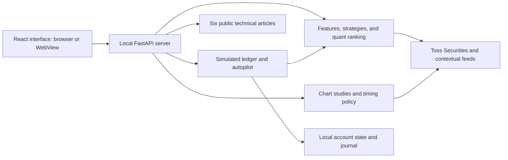

# Earningzone

### A local workstation for stock analysis, chart studies, and simulated trading

**English** · [한국어](README.ko.md)

Earningzone is an independent project that brings market analysis, quantitative screening, chart interpretation, simulated accounts, and strategy evaluation into one browser or Windows desktop application. It combines a React interface with a local FastAPI server and a Python analysis engine, integrating the **Toss Securities Open API** for market data alongside optional contextual feeds.

**Repository:** [minyoungci/Earningzone](https://github.com/minyoungci/Earningzone). The Python package, application files, executable, and local state directory retain their existing `tossbot` names.

The project is intended for developers and individual researchers who want to inspect the rules behind an analysis, experiment with strategies, and understand how a trading decision is constructed.

**Current scope:** the web simulation and autopilot use a local simulated ledger. The chart-confirmed policy is experimental. Scores are heuristics, and the existing backtest does not establish the profitability of that policy. The current application interface and the six in-app technical articles are primarily in Korean; this project manual is available in both English and Korean.

**License status:** a project `LICENSE` has not yet been adopted. The source repository includes bilingual documentation and excludes personal financial materials. See [Publication and licensing](#publication-and-licensing) for the current reuse boundary.

## Contents

- [Features](#features)
- [Toss Securities API integration](#toss-securities-api-integration)
- [Quick start](#quick-start)
- [First session](#first-session)
- [Configuration and storage](#configuration-and-storage)
- [Architecture and components](#architecture-and-components)
- [Analysis and trading logic](#analysis-and-trading-logic)
- [Development and API](#development-and-api)
- [Testing and validation](#testing-and-validation)
- [Packaging and private materials](#packaging-and-private-materials)
- [Troubleshooting](#troubleshooting)
- [Technical documentation](#technical-documentation)
- [Contributing](#contributing)
- [Publication and licensing](#publication-and-licensing)

## Features

| Workspace | What it provides |
|---|---|
| Dashboard | Watchlists, account summaries, allocation, and analysis signals |
| Market | Market regime, macro context, news, economic and earnings calendars |
| Intraday | One-minute candles, VWAP, and intraday-specific signals |
| Quant | Factor scores, curated stock universes, entry plans, and activity indicators |
| Symbol detail | Strategy results, daily/minute charts, causal pivots, retests, and divergence |
| Simulation | Up to eight independent accounts, KRW/USD valuation, manual simulated orders, and a trading journal |
| Autopilot | Account-specific simulated entries and exits, market guards, and persisted position plans |
| Backtest | Walk-forward evaluation of aggregate signals and strategy-category comparisons |
| Portfolio | Portfolio and position summaries for the relevant account/broker path |
| Analysis library | Six searchable public articles explaining the implementation and its limits |

The strategy registry contains **94 daily strategies** across six categories and **five additional intraday strategies**. Quant screening uses curated KOSPI, KOSDAQ, US large-cap, and US growth universes. These are screening universes, not an exhaustive scan of every listed stock.

Chart tools include EMA/SMA overlays, wick/body pivots, fixed ATR zones, sequential breakout/retest tracking, RSI/MACD divergence, RVOL, directional-volume proxies, gaps, and realized volatility. Manual tools add Fibonacci retracements, trend lines, measured targets, assumed-IV expected moves, and cost-aware risk sizing.

## Toss Securities API integration

Earningzone connects to the **Toss Securities (토스증권) Open API**, the securities-market service at `https://openapi.tossinvest.com`. It uses REST polling through [tossbot/client.py](tossbot/client.py); the application does not implement the provider's WebSocket streaming service.

| Integration | Client behavior |
|---|---|
| Authentication | OAuth 2.0 Client Credentials via `POST /oauth2/token`; subsequent requests use a Bearer token |
| Market data | Current prices, order books, recent trades, price limits, and daily/one-minute candles |
| Reference data | Stock metadata, KR/US market calendars, and USD/KRW reference exchange rates |
| Account reads | Account list, holdings, buying power, and sellable quantity; account-specific calls add `X-Tossinvest-Account` |
| Lower-level order adapter | Place/cancel orders and read order status; `TOSS_DRY_RUN=1` prevents the adapter from submitting orders |

The client caches its access token in memory, refreshes it before expiry, serializes concurrent token issuance, spaces requests by API group, and uses bounded retries for HTTP 401/429. These are local implementation safeguards; they do not guarantee a provider quota or uninterrupted data availability.

Supply your own `TOSS_CLIENT_ID` and `TOSS_CLIENT_SECRET` through the application's settings, OS keychain, or process environment. The documented browser/desktop flow handles the keys in the local Python backend. Register the machine's public IP in the provider's allowed-IP settings when required. No working credentials or account records are included in this repository.

The web simulation and autopilot use **local simulated fills**, while live API data supplies their observations. Reading market data or starting the web autopilot does not submit a Toss Securities order. The separate lower-level order adapter must not be treated as a validated live-trading service.

Provider references: [official developer guide](https://developers.tossinvest.com/), [current REST OpenAPI specification](https://openapi.tossinvest.com/openapi-docs/latest/openapi.json), and [WebSocket AsyncAPI specification](https://openapi.tossinvest.com/openapi-docs/latest/asyncapi.json). The REST specification reported version **1.2.19** when checked on **2026-10-06**. API permissions, limits, market-data usage, and availability follow the provider's current terms. The older [local integration notes](TOSS_GUIDE.md) are a dated reference, not the current provider specification.

## Quick start

Clone the repository, then run the remaining commands from the project root, the directory containing this `README.md`:

```shell
git clone https://github.com/minyoungci/Earningzone.git
cd Earningzone
```

### Requirements

| Mode | Requirements |
|---|---|
| Source → local browser | Python 3.10+, Node.js/npm for the initial frontend build, a modern browser |
| Packaged web ZIP | Python 3.10+; the frontend is already built |
| Windows EXE | Windows with Edge WebView2; Python is bundled and Node.js is unnecessary for running the release |
| Live market data | Network access and valid Toss Securities API credentials |
| Offline verification | No market-data credentials; use the synthetic test tools described below |

Use a maintained Node.js release that satisfies the current Vite 5 engine requirement: `^18.0.0 || >=20.0.0`. The latest local validation used Python 3.13 and Node.js 22.15.1 on Windows. The macOS/Linux browser launch scripts are supplied, but they have not received the same platform validation as the Windows package.

### Option A — Run from source

Build the frontend once. The Git source excludes `web/dist`, so skipping this step will not provide the production application screen.

```shell
cd web
npm ci
npm run build
cd ..
```

Then start the local browser application.

**Windows — PowerShell:**

```powershell
.\run.bat
```

**macOS / Linux:**

```bash
chmod +x run.sh
./run.sh
```

The launcher creates a local `.venv`, installs the pinned server requirements when needed, and opens the browser after the server is ready. It binds to `127.0.0.1`, prefers port `8000`, and selects a free port if that port is occupied. Use the actual URL printed in the terminal. Stop the server with `Ctrl+C`.

For a manual Python setup, use the virtual environment's interpreter directly; activation is optional.

**Windows:**

```powershell
python -m venv .venv
.\.venv\Scripts\python.exe -m pip install -r server/requirements.txt
.\.venv\Scripts\python.exe server/launch.py --no-browser
```

**macOS / Linux:**

```bash
python3 -m venv .venv
.venv/bin/python -m pip install -r server/requirements.txt
.venv/bin/python server/launch.py --no-browser
```

These manual commands also require the frontend build above. Open the printed URL yourself when using `--no-browser`.

### Option B — Run the packaged web ZIP

Extract `tossbot-app.zip`, enter its `tossbot-app` directory, and run `run.bat` on Windows or `./run.sh` on macOS/Linux. On macOS/Linux, run `chmod +x run.sh` first if executable permission was not preserved during extraction. The archive includes `web/dist`, so Node.js and a frontend build are unnecessary for running it. The first Python dependency installation and market-data features still require network access.

This is a locally generated distribution artifact. Do not assume a GitHub Release exists until the project actually publishes one.

### Option C — Run the Windows desktop application

For the folder build, keep the entire `dist/tossbot` directory together and launch `tossbot.exe` inside it. The `_internal` directory contains required runtime files. For the single-file build, launch `dist/tossbot.exe`.

The desktop entry point opens a native WebView with an embedded server on a free loopback port. Configure credentials in the application. The current Windows executables are unsigned; code-signing and distribution-channel decisions remain release work.

### Optional full-name search catalog

The public source/archive uses the built-in curated search catalog. The downloaded `tossbot/stock_master.json` is excluded from Git and the web ZIP, with any existing local copy preserved. Symbols outside the catalog can still be resolved by code through the live provider.

If you need a broader name-search catalog, first confirm your access and data-use conditions for KRX/Nasdaq, then generate it locally:

```shell
python build_master.py
```

Restart the application after generation. This downloads third-party listing data and requires network access; it does not expand the quant strategy's curated screening universes. Redistributing that generated file requires a separate data-rights review.

## First session

1. Start the application and enter `TOSS_CLIENT_ID` and `TOSS_CLIENT_SECRET` in the connection banner or settings. Credentials are handled by the backend. When an OS keychain is available, they can be stored there; otherwise the UI reports session-only storage.
2. If your API key is restricted to allowed IPs, add the current environment's public IP through the provider's key settings. Changing networks can require updating that allowlist.
3. Open a stock through search or a watchlist. Check the timestamp, data-quality indicators, and available history before interpreting a signal.
4. Use **모의투자** to choose a simulated account and review its cash and positions. Manual simulated orders and account switching are independent of the chart's manual drawing tools.
5. Open **오토파일럿**, select the target account, market, strategy, position limit, and budget. For the experimental chart strategy, also review the risk percentage and minimum net reward/risk. Execution starts only when you press **시작** and stops with **중지**.
6. Review the journal and the public articles in **분석 스터디** to understand the rules behind the result.

The autopilot captures its account when it starts. Changing the currently displayed account does not redirect a running autopilot. Stopping the loop stops further processing; it does not liquidate positions or cancel a broker-side order. Position plans remain saved, but price protection is not active while the loop/application is stopped.

## Configuration and storage

### Credentials

For the browser launcher and desktop source entry point, the startup precedence is:

```text
Explicit process environment → local .env → OS keychain
```

You can configure credentials through the UI without creating `.env`. For file-based configuration, copy [.env.example](.env.example) yourself and replace the example values before starting the server. The launch scripts do not automatically copy it.

```powershell
Copy-Item .env.example .env
```

```bash
cp .env.example .env
```

Only use this copy command when a `.env` does not already exist. Keep `TOSS_DRY_RUN=1` for the documented research/simulation workflow. For a frozen EXE, prefer the UI/keychain or explicit process variables; placing `.env` next to the executable is not a documented configuration path.

| Variable | Purpose | Default / behavior |
|---|---|---|
| `TOSS_CLIENT_ID`, `TOSS_CLIENT_SECRET` | Toss Securities credentials | Required for live data; can be entered in the UI |
| `TOSS_DRY_RUN` | Dry-run switch for lower-level order clients | `1`; web simulation/autopilot still use the local simulated ledger |
| `TOSSBOT_DATA_DIR` | Override the local state directory | Project root for source; persistent application directory for EXE |
| `ACCESS_TOKEN` | Protect API mutations with a control token | Empty disables the token gate; GET access remains public |
| `CORS_ORIGINS` | Additional allowed frontend origins | Comma-separated exact origins; loopback origins are supported |
| `TOSS_API_URL` | Vite development proxy target | `http://127.0.0.1:8000`; set before starting the frontend dev server |
| `BROKER` | Default lower-level broker selection | `toss`; optional `kis` integration |
| `KIS_APP_KEY`, `KIS_APP_SECRET`, `KIS_ACCOUNT` | Optional KIS client configuration | Unconfigured unless supplied; does not make web simulated orders live |
| `KIS_PAPER` | KIS endpoint selection | `1` selects the VTS endpoint |
| `TELEGRAM_BOT_TOKEN`, `TELEGRAM_CHAT_ID` | Optional notifications and Telegram controls | Disabled when unconfigured |
| `DISCORD_WEBHOOK_URL` | Optional Discord notifications | Disabled when unconfigured |

CLI `run.py` reads process environment settings directly; it does not perform the launcher's `.env`/keychain loading. Export the required variables before using the CLI.

### Local state

| Execution mode | Default state location |
|---|---|
| Source / browser | Project root |
| Frozen Windows EXE | `%APPDATA%\tossbot` |
| Explicit override | Directory specified by `TOSSBOT_DATA_DIR` |

The simulated ledger, broker selection, and CLI paper portfolio are separate state files. Simulated position plans and consumed chart signals persist with their account. Back up local state before a reset; a corrupted ledger is surfaced as an error rather than silently replaced by an empty account. Desktop diagnostics are written to `%APPDATA%\tossbot\desktop.log` on a typical Windows installation.

### Access boundary

The standard launchers bind to loopback. Publishing the source on GitHub does not deploy a hosted application. If you later expose a running instance, `ACCESS_TOKEN` protects mutation endpoints, **not read confidentiality**: GET endpoints can reveal account and journal information. The current control gate is not a multi-user authentication system. Keep accounts and credentials local unless you design the appropriate access model for a hosted service.

## Architecture and components



| Component | Main files | Responsibility |
|---|---|---|
| Web interface | `web/src/App.jsx`, `pages/`, `components/` | Lazy-loaded workspaces, responsive navigation, themes, charts, and connection settings |
| Frontend data layer | `web/src/api.js`, `lib/http.js`, `lib/chartData.js` | Polling, shared GET requests, timeouts, write-triggered invalidation, chart normalization |
| HTTP server | `server/app.py`, `server/launch.py` | API validation, local launch, write controls, upstream errors, and serving the built frontend |
| Indicators and features | `tossbot/indicators.py`, `features.py`, `levels.py` | OHLCV-derived technical features, price levels, and structure |
| Strategy registry | `tossbot/strategies/`, `analysis.py` | Strategy execution and category-weighted BUY/HOLD/SELL aggregation |
| Quant screening | `tossbot/quant.py`, `cache.py` | Factor scores, entry plans, curated universes, bounded caching, and shared computations |
| Causal chart studies | `tossbot/chart_study.py` | Completed-bar filtering, pivot confirmation, fixed zones, retests, and divergence |
| Experimental execution policy | `tossbot/chart_execution.py` | Daily chart eligibility, frozen setup plans, expiration, net reward/risk, and quantity sizing |
| Simulation and autopilot | `tossbot/sim.py`, `autopilot.py`, `journal.py` | Account-specific simulated fills, persistent plans, risk checks, exits, and journal statistics |
| Backtest | `tossbot/backtest.py` | Walk-forward replay of aggregate signals and category comparisons |
| Market context | `regime.py`, `macro.py`, `news.py`, `calendar_feed.py`, `options_flow.py` under `tossbot/` | Regime inputs, contextual feeds, and delayed options activity |
| Broker clients | `tossbot/client.py`, `kis.py`, `brokers.py` | Data/client integrations and separate lower-level order paths |
| CLI paper workflow | `tossbot/engine.py`, `trader.py`, `risk.py`, `portfolio.py` | Command-line analysis and a separate paper-trading state model |
| Notifications | `tossbot/notify.py`, `telegram_bot.py` | Optional outbound alerts and authorized-chat controls |
| Desktop and storage | `desktop.py`, `tossbot/secrets_store.py`, `paths.py` | Native window, embedded server, OS keychain, and persistent state locations |
| Documentation and packaging | `tossbot/financial_library.py`, `make_dist.py`, `build_desktop.py` | Public article allowlist, source/web ZIP, and Windows executable builds |

### Repository layout

```text
.
├── README.md / README.ko.md        English / Korean project manuals
├── NOTICE                         Upstream chart-library attribution
├── .env.example                   Configuration template
├── run.bat / run.sh               Local browser launchers
├── run.py                         Command-line entry point
├── desktop.py                     Native desktop entry point
├── build_desktop.py               Windows packaging
├── make_dist.py                   Public source/web ZIP builder
├── build_master.py                Optional stock-search master regeneration
├── tossbot/                       Analysis, policies, simulation, and integrations
├── server/                        FastAPI application and pinned Python requirements
├── web/
│   ├── src/                       React application
│   ├── tests/                     Node.js unit tests
│   └── package-lock.json          Reproducible frontend dependency resolution
├── tests/                         Python tests, synthetic server, browser checks
└── docs/public/                   Six original public implementation articles
```

Generated `web/dist`, `dist`, and `build` directories are intentionally outside the Git source. The local personal archive and internal audit artifacts are also excluded.

## Analysis and trading logic

### From observations to a score

1. Fetch candles and optional order-book observations.
2. Calculate technical features and run the applicable strategy registry.
3. Aggregate strategy scores using category weights. The configured aggregate thresholds are `+2.5` for BUY and `-2.5` for SELL; intermediate values yield HOLD. Recorded strategy errors force the aggregate direction to HOLD.
4. Build a 0–100 quant score from momentum (30%), trend (25%), strategy aggregation (20%), volume (10%), and timing (15%).
5. Apply the selected policy and account-level execution conditions.

A score of 80 does not mean an 80% win probability. Missing factors can receive neutral substitutions, and indicators derived from the same history are correlated observations.

### Two autopilot policies

| Policy | Behavior |
|---|---|
| `legacy` — default | Aggregate BUY, support-zone entry, score threshold, unheld symbol, and available position slot |
| `chart_confirmed` — experimental | Completed daily candles, confirmed breakout/retest sequence, EMA20/50 alignment, confirmation-bar RVOL, a valid setup, and cost-aware account risk checks |

The experimental policy version is `chart-confirmed-v1`. It requires at least 60 completed daily bars and rejects stale, malformed, or duplicate input. Wick pivots use three bars on each side. A pivot becomes available only after the right-side bars complete.

The sequence requires different bars for **breakout → retest → follow-through close**. The policy also requires `close > EMA20 > EMA50` and confirmation-bar `RVOL ≥ 1.2`. Signal age is limited to two additional completed bars and a four-day expiry measured from the confirmation date's UTC midnight. Stops and targets are determined from information available at confirmation and persisted with the position.

At entry, the policy recalculates net reward/risk and an integer quantity from the current price, FX, cash, budget, equity, and existing open risk. Defaults are a **0.5%** per-trade risk setting and **1.5** minimum net reward/risk. These are engineering defaults, not calibrated recommendations. With the regime guard enabled, missing/degraded inputs block new chart-policy entries; FRACTURE reduces the budget and TRIGGER blocks entries. Exits continue while the loop is running.

Manual drawings, IV assumptions, and manually calculated scenarios are not saved as automatic-trading instructions. Price monitoring is polling-based and is not an exchange-hosted stop order.

### Backtest and journal boundaries

The existing backtest replays the aggregate strategy engine with up to 200 bars, a 60-bar warm-up, next-open signal fills, full-capital entries, and configured costs. Stop/support exits use that bar's closing price. It does **not** replay the entire chart-confirmed portfolio policy, so its results must not be attributed to that experimental policy.

The simulated fee model currently applies a 0.015% per-side fee and a 0.18% sell tax to both KRW and USD instruments. This is not a market-specific real-cost model. The journal counts each SELL fill, including a partial sale, as a trade. Its `expectancyR` field approximates return on invested capital rather than a standard initial-stop-risk R-multiple.

See the [public technical articles](docs/public/README.md) for formulas, confirmation timing, safeguards, and remaining limitations.

## Development and API

### Separate backend and frontend

Install Python requirements into your chosen environment, then start the backend in one terminal:

```shell
python -m pip install -r server/requirements.txt
python server/launch.py --no-browser
```

In another terminal:

```shell
cd web
npm ci
npm run dev
```

Vite prefers port `5173`; use the URL it prints. If the backend uses a different port, configure its actual address before starting Vite:

```powershell
$env:TOSS_API_URL = "http://127.0.0.1:8765"
npm run dev
```

```bash
TOSS_API_URL=http://127.0.0.1:8765 npm run dev
```

The production frontend is served by FastAPI after `npm run build`. Swagger UI is available at the backend's `/docs`, with its schema at `/openapi.json`.

### Selected endpoints

| Method | Endpoint | Purpose |
|---|---|---|
| GET | `/api/health` | Local service health and strategy count |
| GET | `/api/selftest` | Configured live connection diagnostics; can contact the provider |
| GET | `/api/analyze/{symbol}` | Features and strategy results |
| GET | `/api/chart-study/{symbol}` | Causal chart-study output |
| GET | `/api/chart-timing/{symbol}` | Experimental policy's timing and eligibility |
| GET | `/api/quant` | Curated-universe screening |
| GET | `/api/sim/state`, `/api/sim/accounts` | Local simulated account data |
| POST | `/api/sim/order` | Local simulated order |
| POST | `/api/autopilot/start`, `/api/autopilot/stop` | Start/stop a simulated loop |
| GET | `/api/backtest/{symbol}` | Existing aggregate-strategy backtest |
| GET | `/api/financial/library`, `/api/financial/documents/{key}` | Public article search and reading |

The OpenAPI schema is authoritative for request fields and limits. Mutation requests use `X-Access-Token` when the control gate is enabled. Reading a timing endpoint does not start an autopilot.

### Command-line workflows

With credentials already exported into the process environment:

```shell
python run.py --once
python run.py --screen
python run.py --intraday --once
python run.py --paper --once
```

`--paper` is restricted to DRY_RUN and uses a separate paper portfolio; it is not the web simulated-account ledger. Broker clients contain lower-level real-order paths, but real fills, reconciliation, and operational performance have not been validated by this project's simulation tests.

## Testing and validation

### Offline engine and unit tests

```shell
python -m pip install -r server/requirements-dev.txt
python -B selftest.py
python -B -m pytest tests -q -p no:cacheprovider
cd web
npm ci
npm test
npm run build
cd ..
```

The Python tests use synthetic market observations, temporary state, and blocked external requests. `selftest.py` exercises the analysis engine without API credentials. This differs from `/api/selftest`, which diagnoses a configured live connection.

### Offline application preview

```shell
python tests/serve_fixture.py --port 8765
```

Open `http://127.0.0.1:8765` after building the frontend. This verification server substitutes synthetic quotes, isolates its ledger, blocks external urllib requests, and mocks notifications. It is an engineering fixture, not a persistent demo account or a source of market performance results. Stop it with `Ctrl+C`.

Browser smoke scripts are additional host-specific tools. They currently require Playwright at the local development path `.ds-sync/node_modules/playwright` and Edge (`msedge`); that tooling directory is excluded from the public package. Adapt the tooling path in your own environment before running these scripts. Python and frontend unit tests do not require it.

### Desktop package diagnostics

From the source environment with desktop requirements installed, or from a built Windows release:

```shell
python -c "from pathlib import Path; Path('.tmp').mkdir(exist_ok=True)"
python desktop.py --selftest-report .tmp/desktop-check.json
```

```powershell
.\dist\tossbot\tossbot.exe --selftest-report "$env:TEMP\tossbot-check.json"
```

The desktop check avoids GUI/keychain loading and external market calls, uses temporary state, and verifies the embedded API, frontend assets, public documents, and policy guards. It does not certify native-window rendering, real credentials, or broker execution. A windowed EXE can return control to a terminal before the report is written; wait for the process/report when automating this command.

### Latest full validation — 2026-10-06

| Check | Evidence |
|---|---|
| Python suite | 108 passing tests |
| Frontend unit suite | 11 passing tests |
| Production frontend | Vite build completed; 437 modules transformed |
| Chart tools and public articles | 1440, 390, and 320px browser checks; no analysis write requests |
| Source, extracted ZIP, folder EXE, single-file EXE | Offline application diagnostics passed |
| Packaging boundary | Public articles matched source hashes; private documents/images excluded; private API bodies not served |

These results establish behavior under the tested fixtures and Windows environment. They do not establish investment returns, a comprehensive security audit, upstream-data accuracy, or real-market fill quality. Test counts and build metadata are snapshots, not CI badges.

## Packaging and private materials

### Source/web archive

After building the frontend:

```shell
python make_dist.py
```

The builder writes `tossbot-app.zip` and a `BUILD_MANIFEST.json` with SHA-256 hashes. It uses an explicit file/directory selection and permits only six named implementation articles under `docs/public`. It excludes private financial documents, copied source texts, chart images, collection records, internal reports, keys/tokens, local accounts, caches, and local verification artifacts.

Personal source material remains in the author's local archive. It is not discovered by the article API, and the legacy financial-image API does not expose that archive. The public articles explain the code in original prose and use hypothetical examples.

`.gitignore` provides an additional repository boundary; it does not remove files already committed to a Git history. The project repository is [minyoungci/Earningzone](https://github.com/minyoungci/Earningzone). Continue using the verified public file selection and inspect proposed commits rather than staging the entire working folder blindly. Generated full-stock catalogs are also excluded; review data-use conditions before adding them to a custom release.

### Windows executables

```shell
python -m pip install -r server/requirements-desktop.txt
cd web
npm ci
npm run build
cd ..
python build_desktop.py --onedir
python build_desktop.py
```

| Build | Output | Distribution rule |
|---|---|---|
| Folder | `dist/tossbot/tossbot.exe` | Distribute the entire `dist/tossbot` folder |
| Single file | `dist/tossbot.exe` | Distribute the executable with required release notices/documentation |

Build on the target operating system; a Windows executable is not a cross-platform binary. `--console` keeps a console for diagnostics. Only the six named public articles are included as application documents. Preserve third-party license notices when preparing public executable releases.

## Troubleshooting

| Symptom | Check / next step |
|---|---|
| No production screen after cloning | Run `npm ci` and `npm run build` inside `web`; Git does not contain `web/dist` |
| API key banner or authentication error | Check both credential values, startup precedence, and the provider's allowed-IP configuration |
| Development frontend cannot reach the API | Use the backend's printed port and set `TOSS_API_URL` before `npm run dev` |
| Analysis request returns 502 | Check network/provider availability; upstream failures are not successful analyses |
| Screening request returns 503 / retry notice | A shared heavy computation may be in progress; honor `Retry-After` and retry |
| No chart-confirmed entry | Inspect completed-bar count, freshness, pivot/retest state, EMA/RVOL filters, expiry, current-price range, regime inputs, net reward/risk, and account risk/cash |
| No EMA200 line | At least 200 completed observations are needed; excluding the current daily candle can leave fewer |
| Keychain cannot store credentials | Use explicit environment variables or the reported session-only UI configuration |
| Ledger load error | Preserve the state file and inspect/restore a known backup; do not overwrite it to suppress the error |
| Desktop window fails to open | Check WebView2 and `desktop.log`; run package diagnostics to separate server/assets from native-window issues |
| `.venv` activation is blocked in PowerShell | Use `.venv\Scripts\python.exe` directly; changing machine-wide execution policy is unnecessary |

## Technical documentation

The implementation articles are currently in Korean and are also accessible through the application:

| Document | Focus |
|---|---|
| [Public article index](docs/public/README.md) | Scope, reading order, and the overall pipeline |
| [Analysis pipeline](docs/public/ANALYSIS_PIPELINE.md) | Features, category aggregation, and quant-score construction |
| [Chart methods](docs/public/CHART_METHODS.md) | Causal pivots, retests, divergence, volume, and manual formulas |
| [Trading policy](docs/public/TRADING_POLICY.md) | Entry sequence, frozen plans, account guards, signal reuse, and exits |
| [Risk and backtest](docs/public/RISK_AND_BACKTEST.md) | Cost/FX sizing, open risk, fill assumptions, and performance boundaries |
| [Data and limitations](docs/public/DATA_AND_LIMITS.md) | Input coverage, unavailable feeds, timestamps, and public-material boundaries |

Additional references: [desktop notes](DESKTOP.md), [web distribution guide](DIST_README.md), [Telegram setup](TELEGRAM_GUIDE.md), and [local API reference notes](TOSS_GUIDE.md). Provider rules can change; confirm current terms and API behavior with the provider before relying on older reference notes.

## Contributing

Use the [repository](https://github.com/minyoungci/Earningzone) for reproducible defect reports and implementation discussions. A project license must be established before the project offers an open-source contribution/reuse model. Useful areas include clearer rule explanations, synthetic regression cases, data-quality handling, platform verification, and improvements to the research workflow.

Describe the behavior being changed, distinguish analysis-only tools from execution paths, and include relevant verification. Keep account/credential contracts intact. Do not commit personal study materials, API keys, account files, or outputs containing private data. Changes to financial rules should document their assumptions and failure conditions, rather than presenting an unvalidated change as a performance improvement.

## Publication and licensing

**Project license: pending.** There is currently no root `LICENSE`. A public GitHub repository and an open-source license are different decisions; [GitHub's licensing guidance](https://docs.github.com/en/repositories/managing-your-repositorys-settings-and-features/customizing-your-repository/licensing-a-repository) explains the distinction. Do not infer an MIT or Apache-2.0 grant for Earningzone from the licenses of its dependencies.

The source repository is [minyoungci/Earningzone](https://github.com/minyoungci/Earningzone); a binary release is a separate step. The maintainer still needs to adopt a project license before granting open-source reuse permissions. Dependency licenses, provider terms, and any stock-master or reference data added to a custom distribution require their own attribution and redistribution review. Passing the private-document packaging checks is not a blanket certification of those rights.

### Third-party acknowledgments

Charts use **[TradingView Lightweight Charts](https://www.tradingview.com/)**, currently version 4.2.3, under Apache-2.0. Its upstream attribution is preserved in [NOTICE](NOTICE). Preserve the required [license and attribution](https://tradingview.github.io/lightweight-charts/docs/4.2#license-and-attribution) when modifying or distributing charts. The chart's attribution logo provides the TradingView link by default; the upstream notice must also be retained.

React, Vite, Framer Motion, FastAPI, Starlette, Uvicorn, pywebview, keyring, and PyInstaller retain their respective upstream licenses. This acknowledgment is not an exhaustive dependency-license inventory. Toss Securities/KIS APIs, market feeds, and downloaded listing data remain subject to their providers' terms.
